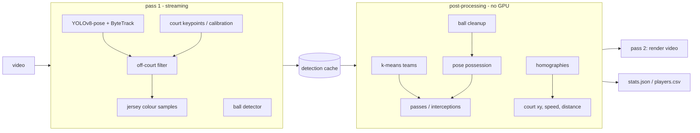

# Real-Time Basketball Analytics Pipeline

**CourtVision** turns basketball footage into an annotated video and a stats file: player tracking, automatic team assignment, **pose-based ball possession**, passes and interceptions, a live top-down court map, and each player's speed and distance in real-world units.

```bash
pip install -e .
courtvision game.mp4 --benchmark
```

> **Origin.** Inspired by Code In a Jiffy's YouTube tutorial *Build an AI/ML NBA Basketball Analysis system with YOLO, OpenCV, and Python* ([abdullahtarek/basketball_analysis](https://github.com/abdullahtarek/basketball_analysis)). This repo is a separate implementation with its own design (see [How it differs](#how-it-differs-from-the-tutorial)). The code was written with **Claude (Anthropic)**, and commits are marked that way.

---

## Features

| | |
|---|---|
| **Player detection + tracking** | One YOLOv8-pose model gives boxes *and* 17-point skeletons; Ultralytics ByteTrack keeps IDs |
| **Off-court filtering** | People whose feet project outside the court (bench, crowd, cameramen) are dropped |
| **Team assignment** | Unsupervised: torso colour samples per track → k-means in CIELAB → majority vote per track. No labels, no per-game setup |
| **Ball tracking** | Top-5 low-threshold candidates per frame; the tracker keeps the one consistent with the ball's motion, then fills short gaps |
| **Possession** | Palm-to-ball distance from wrist + elbow keypoints, normalised by body height; hysteresis smoother tolerates dribbles and back-fills switches |
| **Passes / interceptions** | From the possession timeline and team labels |
| **Court mapping** | Homography from a one-time click calibration (fixed camera) or a per-frame court-keypoint model (moving camera) |
| **Speed + distance** | Metres on the court, symmetric smoothing, glitch rejection |
| **Outputs** | Annotated MP4 (HUD, event banners, minimap) + `stats.json` + `players.csv` |
| **Tooling** | YAML config, detection cache, per-stage benchmark, possession evaluation harness, 40 unit tests |

## How it differs from the tutorial

| | Tutorial | This repo |
|---|---|---|
| Memory | Loads the whole video into a list of frames | Streams frames in two passes, so memory stays flat for any clip length |
| Player detector | Fine-tuned YOLO + separate tracker | YOLOv8-pose: detection, skeleton and tracking in one call |
| Teams | Zero-shot CLIP with text prompts per game ("white shirt" / "dark blue shirt") | k-means on jersey colour; works on any matchup with no prompts |
| Possession | Ball vs. 14 points on the player's *bounding box*, 11-frame counter | Ball vs. *hands* (pose), scale-normalised, hysteresis + back-fill |
| Court | Trained court-keypoint model required | Click-calibration tool for fixed cameras, optional keypoint model for broadcast |
| Minimap | Static court image | Court drawn from official NBA dimensions in code |
| Speed | Frame-to-frame distance | Symmetric smoothing + physically impossible steps rejected |
| Off-court people | Counted as players | Filtered by court position |
| Output | Video only | Video + JSON/CSV stats |
| Config / tests | Hard-coded constants, no tests | YAML config with typo checking, 40 pytest tests |

---

## Pipeline



Because detection results are cached, every post-processing parameter (possession radius, smoothing, team sampling…) can be tuned and re-run in seconds without a GPU.

---

## Quickstart

```bash
git clone https://github.com/Lahanas/Real-Time-Basketball-Analytics-Pipeline.git
cd Real-Time-Basketball-Analytics-Pipeline
pip install -e ".[dev]"

courtvision path/to/game.mp4                       # defaults; weights download automatically
courtvision game.mp4 -c configs/default.yaml -o outputs --cache cache/game.pkl
courtvision game.mp4 --max-frames 300 --benchmark  # quick test + timing
```

Outputs go to `outputs/`:

- `game_annotated.mp4`: players coloured by team with IDs, ball, possession marker, speed and distance, ball-control bar, pass and steal counters, event banners, live minimap, frame number
- `game_stats.json`: team possession %, passes, interceptions; per-player distance, average and top speed, possession time; full event timeline with timestamps
- `game_players.csv`: the player table, ready for a spreadsheet

### Court mapping (needed for the minimap, speed, distance and off-court filtering)

**Fixed camera** (gym, tripod): click the visible landmarks once.

```bash
python tools/calibrate.py game.mp4 -o configs/my_gym.json
```

Then set `court.calibration: configs/my_gym.json` in your config. Six or more points spread across the court work best; the tool prints the reprojection error.

**Moving broadcast camera:** train a YOLOv8-pose model on court landmarks (e.g. a Roboflow basketball-court keypoint dataset), then set `models.court_keypoint_model` and list its keypoint order in `court.keypoint_names` using the names in `courtvision/court.py → LANDMARKS`. A homography is solved per frame with RANSAC; frames with fewer than 4 confident landmarks reuse the nearest one.

Without either, everything except the minimap, speed/distance and off-court filter still runs.

### Fine-tuned models (recommended for broadcast footage)

Out of the box everything runs on stock COCO weights, which is enough for a fixed gym camera but weak on broadcast video:

- **Ball**: COCO's `sports ball` misses small, blurred balls and fires on look-alikes. Fine-tune a single-class YOLO on a basketball dataset (e.g. from Roboflow Universe) and set `models.ball_model` and `models.ball_class: 0`.
- **Players**: the pose model also detects the crowd and bench. Off-court filtering removes them when the court is mapped; otherwise train a player-only detector and set `models.player_detector`. Skeletons are then attached to its boxes by IoU.

## Test run

Smoke-tested end to end on a 117-frame 720p broadcast clip, on CPU, with stock `yolov8n-pose` and COCO `yolov8s` (numbers from one clip, not a benchmark):

- Tracking, team split by jersey colour, overlays and stats export all worked.
- Player detection needed `imgsz` 1280: at 640 only ~2 players per frame were found.
- **The generic ball detector was the weak link.** At 1280 px / conf 0.15 it found the ball in 15 of 117 frames. Running it at 640 px with a 0.05 threshold and motion-based candidate selection raised that to 64 raw frames and 114 after tracking. On broadcast footage it still locked onto false positives at times (e.g. the basket stanchion), so possession and pass counts on broadcast video need the fine-tuned ball detector above.

---

## Evaluation

### Possession accuracy

```bash
courtvision clip.mp4 --dump-possession          # writes outputs/clip_possession.json (pose + box-only)
# label who holds the ball: start_frame,end_frame,player_id  (see evaluation/labels_template.csv)
python evaluation/evaluate_possession.py outputs/clip_possession.json labels/clip.csv
```

`bbox` is the same pipeline with pose disabled (`possession.use_pose: false`), so the comparison isolates what the hand keypoints add. A predicted possession counts as a **false positive** if fewer than half its frames match the labelled holder.

| Method | Frame accuracy | False-positive events | Missed | Holder switches |
|---|---|---|---|---|
| box only | _todo_ | _todo_ | _todo_ | _todo_ |
| **pose** | _todo_ | _todo_ | _todo_ | _todo_ |

<sub>Fill in from your own labelled clips; state how many clips and possessions.</sub>

### Speed

```bash
courtvision clip.mp4 --benchmark
```

prints time per stage and end-to-end FPS. GPU: _todo_ · FPS: _todo_

---

## Project structure

```
courtvision/
  cli.py          command-line entry point
  pipeline.py     two-pass orchestration + cache
  detection.py    YOLOv8-pose + ByteTrack, ball, court keypoints
  ball.py         velocity gating + gap interpolation
  teams.py        jersey colour sampling + k-means voting
  possession.py   hand-based candidate + hysteresis smoother
  events.py       passes / interceptions
  court.py        NBA geometry, landmarks, homography, minimap
  kinematics.py   court positions, speed, distance
  stats.py        summary + JSON/CSV export
  render.py       overlays, HUD, banners, minimap
  config.py       dataclass config, YAML loading
tools/calibrate.py               click-to-calibrate fixed cameras
evaluation/evaluate_possession.py
configs/default.yaml
tests/                           40 tests, no GPU or weights needed
```

## Tests

```bash
pytest -q
```

They cover hand vs. box disambiguation, scale invariance, wrist fallback, dribble gaps, back-fill, ball gating and interpolation, team clustering and vote robustness, homography round-trips, speed on known motion, glitch rejection, pass/interception logic, stats, rendering and the evaluation metrics.

## Known limitations

- Referees are tracked as players and get whichever team their shirt is closest to. A third k-means cluster or a referee class in the detector would fix this.
- Track IDs can switch after long occlusions (ByteTrack limitation), which splits one player's stats across two IDs.
- Possession needs the ball to be detected near a hand; balls hidden behind bodies rely on the interpolation and gap tolerance.
- Speed and distance are only as good as the homography; check the calibration's reprojection error.

## License

MIT, see `LICENSE`.
